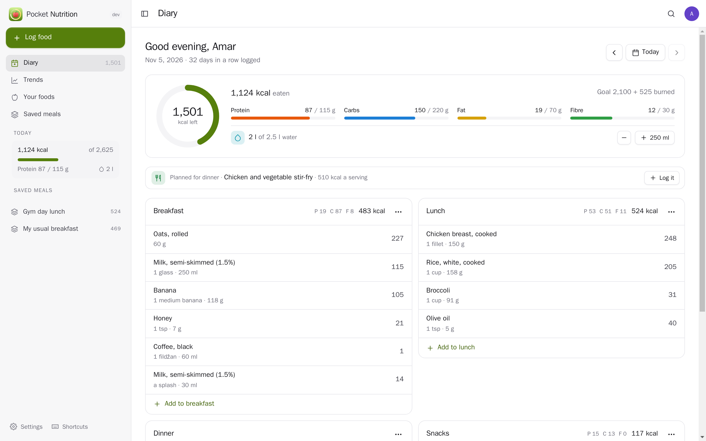
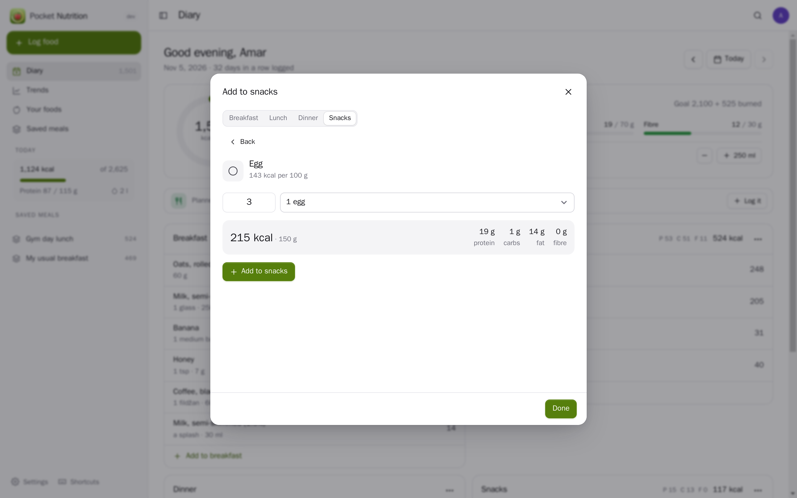
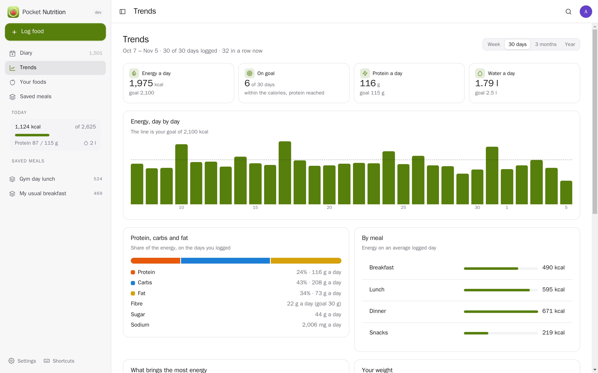
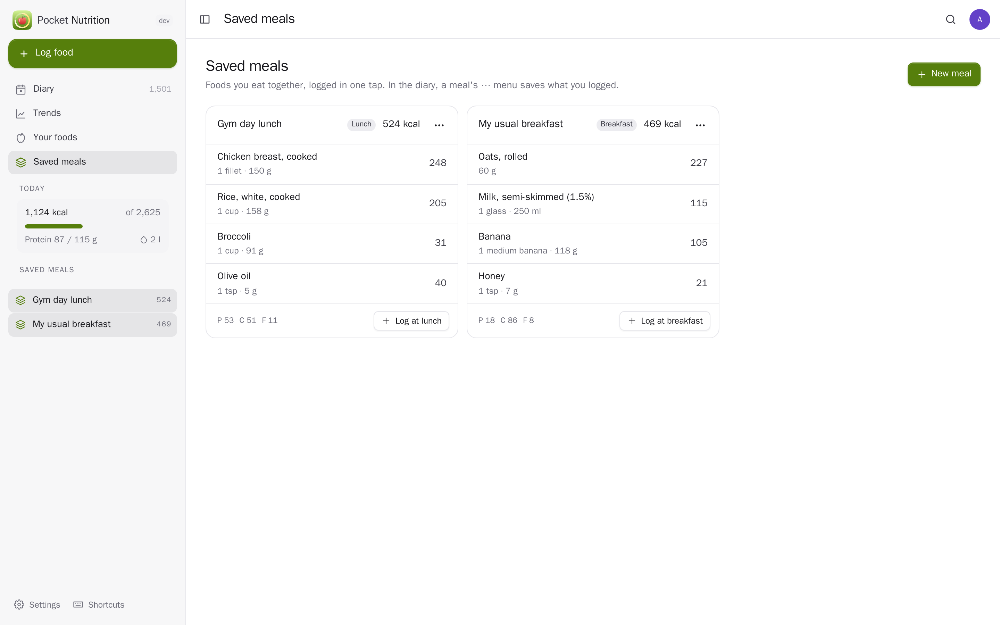
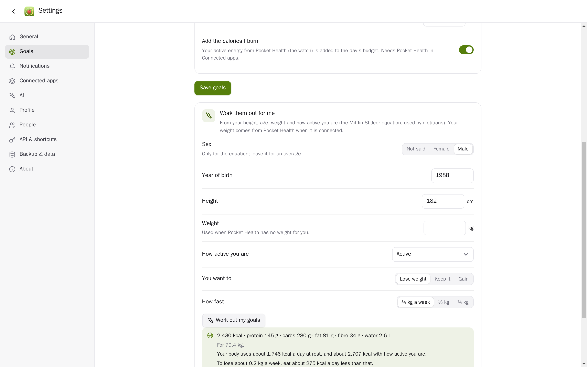
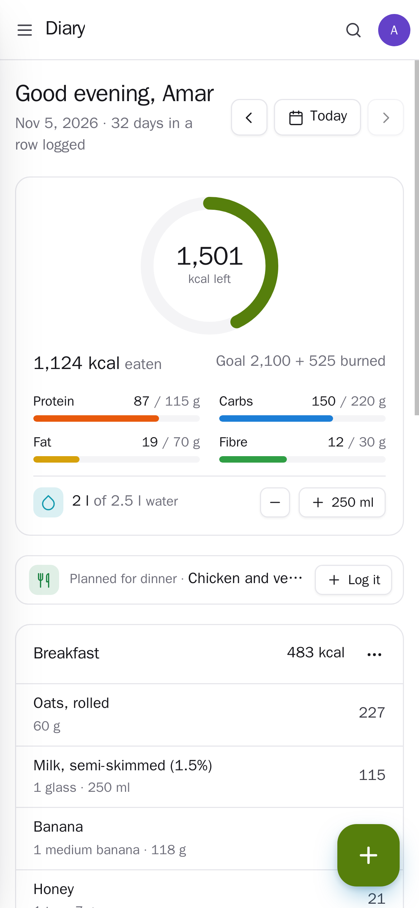
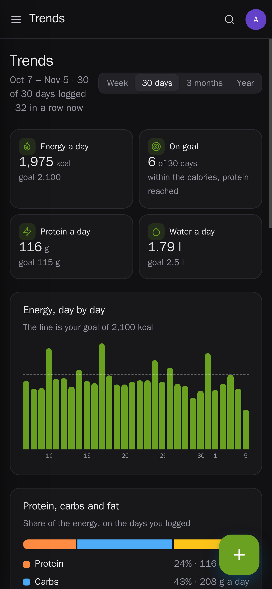

<p align="center"></p>
<h1 align="center">Pocket Nutrition</h1>
<p align="center">Your food diary: what you eat meal by meal with calories, protein, carbs and fat, water, goals worked out for you, your own foods and saved meals, a built-in list of everyday foods and barcodes looked up on Open Food Facts. It logs recipes from Pocket Kitchen, takes your weight and calories burned from Pocket Health and records each day there, and with Pocket AI logs a meal you describe in a sentence. Imports from MyFitnessPal and Cronometer.<br>One Go binary, one SQLite file, one volume. Part of the Pocket apps; works on its own too.</p>
<p align="center">
  <a href="https://github.com/abjelosevic88/pocket-homelab-nutrition/actions"></a>
  <a href="https://github.com/abjelosevic88/pocket-homelab-nutrition/pkgs/container/pocket-homelab-nutrition"></a>
  <a href="LICENSE"></a>
</p>

---

<p align="center"></p>

<table>
  <tr>
    <td width="50%"></td>
    <td width="50%"></td>
  </tr>
  <tr>
    <td align="center"><sub>Log food: search (“jaje” finds Egg), a serving and how many, the numbers as you type.</sub></td>
    <td align="center"><sub>Trends: every day against your goal, the averages, protein/carbs/fat, by meal, your weight.</sub></td>
  </tr>
  <tr>
    <td width="50%"></td>
    <td width="50%"></td>
  </tr>
  <tr>
    <td align="center"><sub>Saved meals: your usual breakfast in one tap.</sub></td>
    <td align="center"><sub>Goals: worked out for you (Mifflin-St Jeor), or your own.</sub></td>
  </tr>
  <tr>
    <td width="50%"></td>
    <td width="50%"></td>
  </tr>
  <tr>
    <td align="center"><sub>Made for the phone: one tap to log, one for a glass of water.</sub></td>
    <td align="center"><sub>Light and dark follow the system.</sub></td>
  </tr>
</table>

## What it does

- **A diary by meal**: breakfast, lunch, dinner and snacks, each food with its amount and numbers; calories left of the day's budget, protein, carbs, fat, fibre, and a water counter. Copy a meal from the day before, move or change an entry, undo a removal, a note for the day.
- **Finding food fast**: your usual foods for that meal first, then a built-in list of about 170 everyday foods (with local ones: ćevapi, burek, somun, ajvar, kajmak) found in English or Bosnian (“jaje”, “pivo”). Scan a pack's barcode (the camera, or a photo on iPhone) and it is looked up on Open Food Facts; or search Open Food Facts by name.
- **Say it in a sentence**: “two eggs, toast with butter and a coffee with milk” — Pocket AI finds your foods and the built-in ones, estimates the rest, and you check it before it is logged.
- **Your foods and saved meals**: add a food from its label (per 100 g, per 100 ml or per serving, with servings like “1 slice”), or let Pocket AI fill in typical numbers; save the foods of a meal to log again in one tap.
- **Goals**: calories, protein, carbs, fat, fibre and water, worked out from your height, age, weight and how active you are — or your own. Count the calories you burn (Pocket Health) if you want.
- **Trends**: a week, 30 days, 3 months or a year: every day against the goal, days on goal, the averages, the split of protein, carbs and fat, what brings the most energy, each meal's share, your weight; and your eating in plain words from Pocket AI, with ideas for the next meal.
- **Messages**: in the evening what is left of your day (or that nothing is logged yet), the morning after how it went, on Mondays the week (Apprise, ntfy or a webhook).
- **Bring your history**: MyFitnessPal's and Cronometer's exports; importing twice adds nothing. Export everything as JSON or the diary as CSV.
- **Everyone their own**: each person has their own foods, diary, goals, settings and connections; admins see no one else's.

## Run it

```sh
docker run -d --name pocket-nutrition -p 8080:8080 -v ./data:/data \
  -e BASE_URL=https://nutrition.example.com -e SECURE_COOKIES=true \
  ghcr.io/abjelosevic88/pocket-homelab-nutrition:latest
```

or `docker compose up -d` with [docker-compose.yml](docker-compose.yml). Open it, create the first account and log your breakfast. All options: [docs/configuration.md](docs/configuration.md). API: [docs/api.md](docs/api.md).

## With Pocket Core

Set `CORE_URL` and `CORE_REGISTRATION_KEY` and Nutrition joins the box: people sign in with Pocket Core, and through app links each person's Nutrition reaches their own Pocket apps with nothing to paste (or directly with a URL and token, per person).

| App | What Nutrition does there | Scopes |
|---|---|---|
| Pocket Health | records each day's calories, protein, carbs, fat, fibre, sugar, sodium and water; your weight for goals and trends; the calories you burn added to the day if you want | `health:read`, `health:write` |
| Pocket Kitchen | logs a recipe you cooked by the serving with its nutrition; shows the meals you planned for the day, to log in one tap | `recipes:read`, `plan:read` |
| Pocket Fitness | shows the day's workouts — a training day can have more to eat | `fitness:read` |
| Pocket Habits | ticks the habit you choose on logged days, or only on days on goal | `habits:read`, `entries:write` |
| Pocket Places | shows the restaurant or café you visited that day, so the meal gets logged | `places:read` |
| Pocket AI | a meal from a sentence, your eating in plain words, ideas for the next meal, typical numbers for a new food; the Ask button on every page | inference |

Other apps can read and log your food (`nutrition:read`: each day's meals in Pocket Day's journal, the Nutrition card in Pocket AI's briefing, the `pocket_nutrition_*` tools Pocket AI uses to answer “how much protein did I have today?”; `nutrition:write`: “log two eggs and toast for breakfast” from Pocket AI). Events: `nutrition.meal_logged`, `nutrition.day_summary`, `nutrition.goal_met`, `nutrition.streak`.

Pocket Search, Pocket Day and Pocket Hub find Nutrition on their own. Nutrition tells Pocket Core what it can do and answers on four fixed addresses, one link each, always as the person asking: `GET /api/v1/pocket/search` (your foods and saved meals by name, and the days you ate a food; `!nutrition` or `!food` in Pocket Search), `GET /api/v1/pocket/day/{date}` (what you ate that day, meal by meal, with the calories against your goal and the water), `GET /api/v1/pocket/widget` ("Today's food": today's calories against your goal, protein, carbs, fat and water, and each meal so far) and `POST /api/v1/pocket/capture` (a line typed in the Hub is logged in the meal for this hour: one of your foods by its name, or a name with its calories like "Cake at work 350 kcal"; sent twice, it is still one entry). Nothing about Nutrition has to be added to those apps.

## Develop

```sh
make dev     # API on :8080 with demo data (four months of meals, made-up linked apps) + Vite on :5173
make test    # go vet, go test, tsc
make         # web + binary
```

The built-in foods carry typical values from food composition tables, rounded; a pack's label always wins. MIT licensed.
